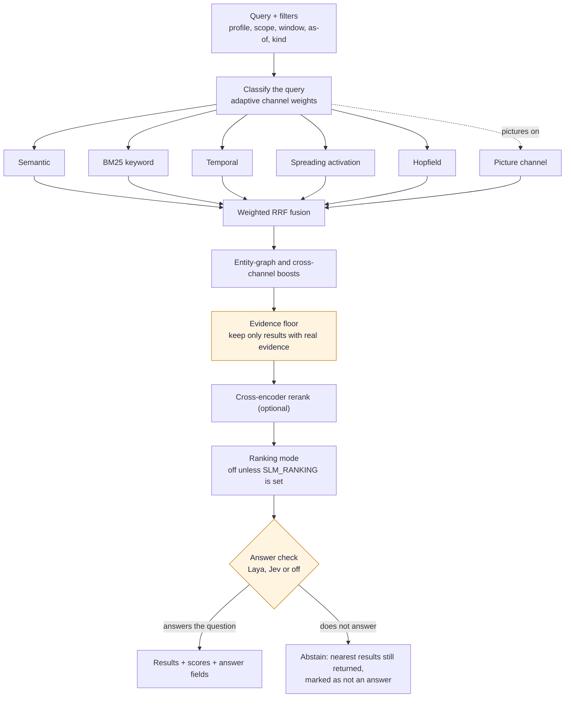

# How Recall Works

Recall answers one question: which stored memories are the best evidence for this query? It is built so that a bad match is dropped instead of dressed up, and so that an agent can tell "I found something related" from "I found the answer".

## The path at a glance

[Download as PNG](images/recall-flow.png)

Code: `core/recall_pipeline.py` (`run_recall`), `retrieval/engine.py` (`RetrievalEngine.recall`), `retrieval/fusion.py`, `retrieval/media_channel.py`, `core/answer_check_stage.py`, `core/judge_selection.py`.

## The producers

A query is first classified, and the classification sets the weight each producer gets. Five producers run in parallel, and each reports only if its index is healthy, so a recall degrades to what is available instead of failing.

| Producer | What it matches | Best for |
|---|---|---|
| Semantic | Dense vector similarity | The same meaning in different words |
| BM25 | Keyword match with term weighting | Names, codes and exact terms |
| Temporal | Time references and event order | "What did we decide last Friday?" |
| Spreading activation | Linked neighbourhoods in the graph | Multi-hop related evidence |
| Hopfield | Associative recall over stored representations | Linked decisions and technical context |
| Picture channel | What a picture or PDF page shows | "The slide with the quarterly numbers" |

The picture channel only exists when pictures and documents are on, `media.db` exists and the profile has at least one picture vector. Otherwise it is not even submitted, and a recall is exactly what it was without it. Its query vector comes from a media worker that is already warm, asked at most once and for at most a third of a second. If the worker is cold, it starts in the background, this recall goes on without pictures and says so with a `warming` status. Why: a recall must never wait for a model to load.

The entity graph is not a producer. It scores and boosts fused candidates afterwards, when enabled and within the time budget.

## Fusion, the evidence floor and reranking

The ranked lists are combined with weighted reciprocal rank fusion (k = 15). Fusion rewards agreement between channels without needing their scores to be comparable.

The **evidence floor** comes next, before the optional cross-encoder. A result stays only if it earned real evidence: a semantic cosine of at least 0.60 (a model with its own floor uses that instead, because similarity scores are not comparable between models), or a non-zero BM25, entity-graph or temporal score, or it is a pinned fact. A picture saved with no readable text (a wordless picture) is judged differently, because its other text channels only matched a saving label or a file name: it stays if its picture-channel score reaches the media floor (0.30 by default) or the words of your own note matched by BM25. Such a picture also keeps the position fusion gave it, because a text reranker would only be scoring its label, and the answer check reports it as not judged (`media_unjudged`). Spreading activation and Hopfield do not count as evidence on their own, because they find related material, not matching material. The floor runs before the result limit is applied, so a qualified candidate just below the cut cannot be pushed out by associative hits that the floor would then remove.

If nothing survives, the recall succeeds with an empty list and `abstained: true`, reason `evidence_floor`. If candidate generation finds nothing at all, the reason is `no_candidates`. Neither case involves a judgment about the results; there were none to judge.

The cross-encoder then reorders the qualified pool. It never blocks: with no model loaded, the fused order is returned and the model warms in the background.

## Ranking mode

Learned adaptive ranking is off. Unless you set `SLM_RANKING` to `v1`, `v2` or `v2-ensemble`, recall order comes from fusion and the reranker. An upgrade never turns it on, because a memory system's answers should change when the evidence changes, not because a learned weight drifted.

## The answer check

After ranking, an optional answer check looks at the top three results and decides whether they actually answer the question. It adds fields; it never hides a result.

| Choice | Where it runs | What leaves your computer |
|---|---|---|
| On this Mac (Laya) | A small on-device model, Apple Silicon only | Nothing |
| Online with Jev | A hosted provider you choose, with your own key and explicit consent | The question and the top memories |
| Off | Nowhere | Nothing |

The setting `auto` uses Laya only when it is installed and supported, and otherwise stays off. `auto` never resolves to Jev, so data leaves the machine only when someone chose that. For one recall, `answer_check_status` is `judged`, `off`, `skipped`, `busy`, `warming` or `unavailable`. A skipped or unavailable check costs only the verdict. The memories, their order and their scores are unchanged. See [Answer Check](Answer-Check).

## Scores rank, they do not predict

| Field | Meaning |
|---|---|
| `relevance_score` | Query-relative relevance, bounded 0.0 to 1.0, comparable only within one release and configuration |
| `ranking_score` | Internal utility after reranking or adaptive adjustment; a diagnostic, not a probability |
| `memory_confidence` | Confidence stored with the assertion; not relevance and not answer correctness |
| `trust_score` | Trust signal on the evidence; not answer confidence |
| `rank_position` | One-based position in the returned list |

Every response declares `calibration_status: "uncalibrated"` and `answer_confidence: null` unless an answer check produced a verdict. Do not double, threshold or average these scores into a probability. The full contract is in [Retrieval Score Contract](Retrieval-Score-Contract).

## Asking about time and scope

Recall accepts a time window, `as-of` and `known-as-of` dates, and a `valid-at` date, so you can ask what was true last month or what SLM knew before a given day. Reads default to your own profile; shared and global memories join a recall only when you ask for them or an operator enables the policy. See [Profiles](Profiles).
